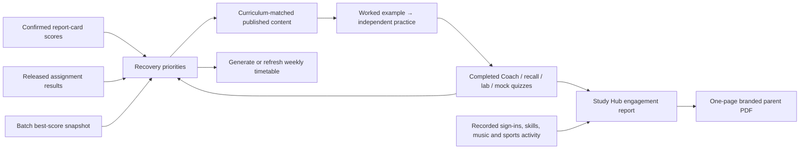

# Learning Coach audit and feedback loop — 25 November 2026

## Findings

The existing Coach securely stored report cards, required score confirmation, created topic plans and scheduled reviews. The timetable already combined several results sources. However, the Coach screen was gated by the report upload and filtered its main queue by the original RED report-card subjects. New weaknesses from other quizzes could be missed, improvement did not remove that screen's stale focus, and the Study Hub had no unified student engagement report. A worked example was repeated within the same quiz; editable answers could change the same practice session after feedback.

## Delivered flow

## Behaviour and safeguards

- Latest completed practice drives recommendations on read, without rewriting school assessments or generating unreviewed content. A rolling weighted five-result estimate (90-day window) updates the subject focus. Report-card scores are a cold-start baseline, not a permanent weakness label. This estimate is not a term grade or proof of mastery.
- Subject aliases are normalised. Enrolment, grade, publication, school/stream distribution and subscription access remain mandatory for content recommendations. Missing reviewed content is stated honestly. Direct Coach starts also enforce enrolled subjects.
- Worked examples are separate from independent quiz questions. A minimum three-question pool supplies one example and at least two independent questions. Answers are first-attempt records. Session and plan row locks prevent concurrent retries from double-completing or inflating scores.
- Coach/Study Hub show study content and quick-practice links. Existing formal teacher assignments are not replaced or silently altered. Timetable generation uses the same current priorities; an already saved timetable remains stable until the learner regenerates it. Recall quiz evidence is archived in server-owned timetable JSON so refreshes and repeat quizzes preserve prior evidence, with stable IDs preventing double counts.
- Reports are learner-owned, role-protected and `private, no-store`. They contain no answer keys, uploaded report documents, parent telephone numbers, IP addresses or audio recordings. Download and sharing are initiated by the learner.
- Existing tables suffice; no schema migration or taxonomy seed is introduced.

## Parent report

Choose 7, 30 or 90 days in **My Study Hub → Reports**. A4 PDF is strictly one page: clean brand header; reporting period and latest recorded sign-in; active days, sign-in count, average activity score and timetable check-offs; doughnut charts for activity mix and subject support levels; up to four subject rows; one plain-language next action; three latest events with EAT dates/times. The web view includes all returned subjects and a paginated recorded timeline.

The PDF uses embedded Open Sans fonts from the existing frontend assets, a correctly cropped existing wordmark and vector charts. It has no remote rendering dependencies.

## Evidence limits

Sign-ins and recorded presence do not measure actual attention or study duration. There is no invented “hours studied” statistic. Timetable completion is learner-reported. Music project saves and sports progress have latest-record timestamps, not a full edit history. Activity scores combine completed auto-marked work with released assignment results and are not official school grades. Unreleased grades stay hidden. Batch best scores are explicitly identified as snapshots and are not counted as additional report attempts. Anonymous public quizzes cannot be attributed to a learner.

The report is a discussion aid, not an official KCBE report, certification or teacher judgement. Missing historical events cannot be reconstructed. Parent access is through the learner's downloaded report; this change does not introduce a new parent-account permission model.

## Validation

Unit tests cover refreshed priorities, due reviews, subject restrictions, missing content, score privacy, date windows, worked-example separation and one-page PDF bounds. A disposable PostgreSQL test covers real concurrent answer replay, immutable answers, new weaknesses without report upload, tenant isolation, recorded sign-ins and PDF output. Browser tests cover Study Hub sections, content links, report filters, PDF download and 1440/390/320px layouts. Both tests and a backend readiness gate block frontend publication.
