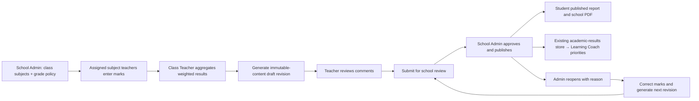

# School Report Book

Grades 1–12. This module is separate from the student's Learning & Engagement Report and the existing SBA scorebook. It uses school-approved marks and policies; it does not silently treat platform practice scores as formal school results.

## Where it lives

- Teacher portal → **Report Book** → **Gradebook**: subject-and-stream assigned marks, weighted assessments, manual remarks and reviewed AI suggestions.
- Explicit Class Teacher → **Class reports**: full-class subject matrix, CSV, report generation, comments and submission for school review.
- School Admin → **Report Book**: school setup, explicit Class Teacher assignment, grade-specific grading policies, approval, publication, reopening with a reason, and revision/audit history.
- School learner → **School reports**: only their own published revisions and PDF downloads. Independent learners continue to use Study Hub progress reports.

## Rules

1. Existing Teacher RBAC code and permissions are unchanged. The new class-teacher grant applies only to report-book class aggregation/report resources. It does not grant another teacher's subject gradebook access or broaden existing student-profile endpoints.
2. All identifiers are checked against the authenticated school. Student records must be active, in the selected grade and stream, and enrolled in the subject. Seniors need exactly three distinct non-core electives; cross-track electives are respected. Junior subject coverage is explicitly configured by the school for the class, not guessed from a universal subject list.
3. Assessment scores are divided by their own maximum and weighted within the subject. Subject results and averages use two-decimal percentages. Missing marks remain Pending. Genuine zeroes count. Neither missing marks nor missing elective setup may be published.
4. The default eight-level preset is an editable example consistent with the application's existing practice bands. It is **not** claimed to be a universally verified official scale for all grades. A School Admin must confirm the appropriate policy for each grade, and changed policies require fresh report generation before publication.
5. Ranking is off by default. It requires complete marks and identical enrolled subject sets; equal averages share the same competition rank. No ranking across different elective sets.
6. Generation produces a new revision. Submitted/released periods lock mark edits. Only the School Admin can reopen, with a recorded reason. Published cards, subject/assessment snapshots, policies, student details and comments are never overwritten. Older published and archived drafts remain available through the report revision selector; students see published versions only.
7. Mark changes, assessment setting changes, comments, policy confirmation, Class Teacher changes, generation, reopening and publication are recorded in the module's change log. Clearing a mark retains its previous value in that log. The staff interface sends saved-row timestamps to detect conflicting edits, and warns before discarding unsaved gradebook work.
8. AI receives pseudonymous record IDs, subject, grade and percentages—not names, admission numbers or uploaded report documents. AI suggestions are separate from approved remarks. Teachers must review and save them; suggestions do not automatically appear on issued reports. Existing AI quotas apply. The subject report uses the most recently saved approved subject remark.
9. Publication checks fresh class enrolment, marks, subject coverage and policy version. A published revision is bridged atomically into the existing AcademicResultBatch/StudentAcademicResult store, enabling Learning Coach/timetable priorities. Unpublished drafts do not feed that loop. Previously published result batches are preserved.
10. PDFs use embedded brand fonts, school letterhead and a trusted-storage school logo when configured. They include every subject, missing-mark indicators, totals, averages, optional comparable ranking, teacher/principal comments and signature blocks. Drafts are clearly marked. Long subject/comment sets continue onto another page rather than losing content. The separate Learning & Engagement Report retains its one-page limit.

## Routes

New protected APIs are under `/api/v1/report-book`: `options`, `policy/:grade`, `periods`, `class-teachers`, `periods/:id/gradebook`, `gradebook/bulk-save`, `gradebook/generate-comments`, `periods/:id/aggregated`, `periods/:id/generate`, `periods/:id/reports?revision=N`, `periods/:id/review`, `periods/:id/publish`, `periods/:id/reopen`, `periods/:id/history`, `reports/:id`, `reports/:id/comments`, `reports/:id/pdf`, `my-reports`. A public capability route verifies schema readiness without publishing marks or credentials.

## Test school

`REPORTDEMO` / Assignment Hub Report Book Demo contains only synthetic learners, two streams (Grade 7 / 7A and Grade 10 STEM / 10B), three subject teachers and one School Admin. Mathematics is the explicit Class Teacher for both streams. Grade 10 learners have Biology, Chemistry and Physics electives. Sample marks are prefilled for Term 1, 2027 so report generation can be tested immediately.

Requested staff provisioning runs once during the production migration command, only on the known production Render service and within its initial setup window. Only strong bcrypt hashes are committed; plaintext credentials remain outside the repository and are supplied privately in the task response. Existing demo accounts and edited results are never reset by deployments. No emails, SMS messages or payment requests are sent.

## Verification

Unit tests cover weighted scoring, missing/zero marks, policy validation, comparable ranking, all grade levels and PDF rendering. Disposable PostgreSQL/HTTP tests cover paired subject/stream access, class-teacher authorization, tenant isolation, atomic saves, AI drafts, policy-version invalidation, publishing, owner-only PDFs, frozen revisions, mark clearing and idempotent demo provisioning. Browser tests cover staff and student workflows, publication, downloads and 1440/390/320px layouts. Migration, backend API readiness, database tests and browser tests block frontend publication.
